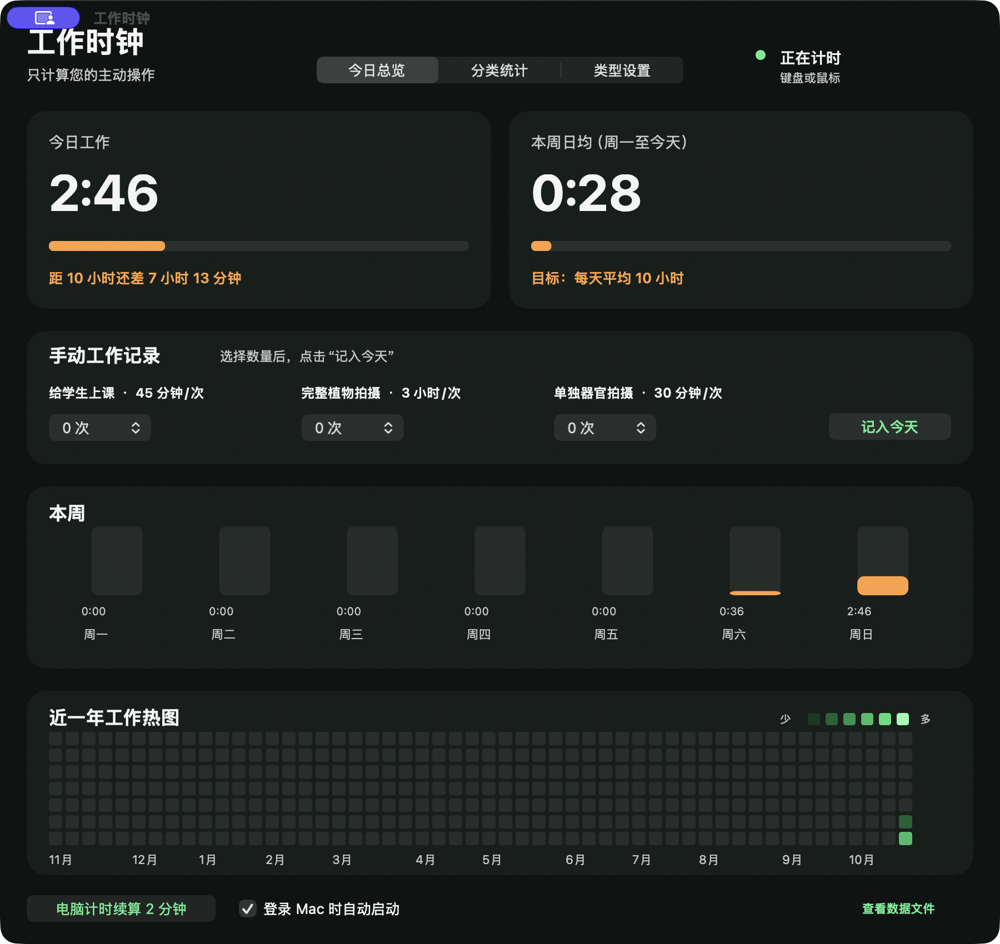

# 工作时钟 / Work Clock for macOS

**版本 / Version:** 1.4.0 (Build 10)  
**平台 / Platform:** macOS 14+ (Native AppKit)

[中文说明](#中文说明) | [English](#english)

## 中文说明

**工作时钟（Work Clock for macOS）** 是一款本地运行的 macOS 原生 AppKit 工作时间记录与统计工具，用于统计电脑前的主动输入时间、记录其他工作时长，并按周期查看统计与年度热图。

### 核心功能

- **自动主动输入计时**：检测到鼠标、触控板或键盘活动后自动计时；若 2 分钟内没有新的主动操作则自动停止，后台程序运行不会触发计时。
- **手动记录其他工作**：无法由电脑检测的工作可手动记录，支持自定义项目名称和单次计入时长。
- **周/月/年统计**：按周、月、年查看工作时长统计。
- **年度热图**：展示近一年的工作时长热图，支持悬停查看每日明细。

### 隐私与数据安全

- **本地存储**：所有统计数据与配置仅保存在本地路径 `~/Library/Application Support/WorkTime/work-time.json`，不上传服务器，无需联网即可使用。
- **不读取第三方内容**：仅检查基础输入活跃状态，不读取、不检测任何 Codex 或 ChatGPT 消息内容。

### 系统要求

- macOS 14.0 或更高版本
- Xcode Command Line Tools（仅从源码构建时需要）

### 从源码构建

1. 安装 Xcode Command Line Tools：

   `xcode-select --install`

2. 进入源码目录并执行构建脚本：

   `cd 01_source && ./build.sh`

3. 构建完成后，生成的应用位于：

   `02_build/工作时钟.app`

### 签名与安装说明

- 当前构建版本采用本地临时签名（Ad-hoc Signing）。
- 本项目未进行 Apple 公证，未使用 Developer ID 正式签名，也未上架 Mac App Store。
- 若首次打开时遇到 macOS Gatekeeper 提示，可在“系统设置 → 隐私与安全性”中手动允许运行，或在本地自行执行构建脚本生成应用。

## English

**Work Clock for macOS (工作时钟)** is a local-only, native macOS AppKit application for recording and reviewing working time. It tracks active input on your Mac, supports manual logging for non-computer work, and provides periodic statistics and a yearly heatmap.

### Features

- **Automatic Active Input Timing**: Automatically tracks time when mouse, trackpad, or keyboard input is detected, and stops after 2 minutes of inactivity. Background processes do not trigger the timer.
- **Manual Work Logging**: Work that cannot be detected by the computer can be logged manually, with customizable item names and duration per entry.
- **Weekly, Monthly, and Yearly Statistics**: View working time statistics grouped by week, month, and year.
- **Yearly Heatmap**: Displays a past-year activity heatmap with daily details on hover.

### Privacy & Data Storage

- **Local Storage Only**: All data and settings are stored locally at `~/Library/Application Support/WorkTime/work-time.json`. No data is uploaded over the network.
- **No Codex/ChatGPT Inspection**: This version only checks basic input activity and does not read, monitor, or detect Codex or ChatGPT messages.

### Requirements

- macOS 14.0 or later
- Xcode Command Line Tools (required for building from source)

### Build from Source

1. Install Xcode Command Line Tools:

   `xcode-select --install`

2. Navigate to `01_source` and run the build script:

   `cd 01_source && ./build.sh`

3. The compiled application bundle will be output to:

   `02_build/工作时钟.app`

### Code Signing Notice

- The application is built using local ad-hoc signing.
- It is not notarized by Apple, not signed with a Developer ID certificate, and not distributed via the Mac App Store.
- If macOS Gatekeeper blocks the app on first launch, allow it in **System Settings → Privacy & Security**, or build the app locally from source using `./build.sh`.

For detailed instructions, see [docs/USER_GUIDE.md](docs/USER_GUIDE.md).
